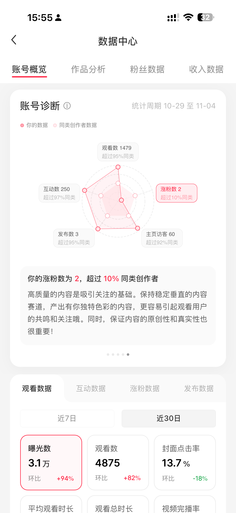
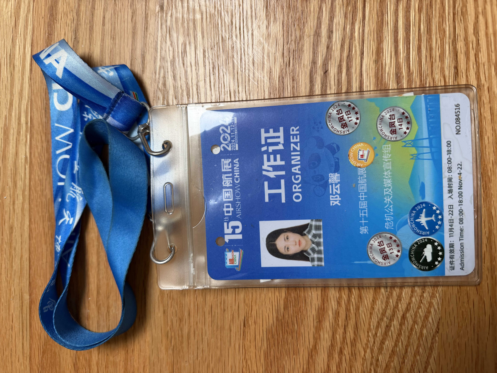
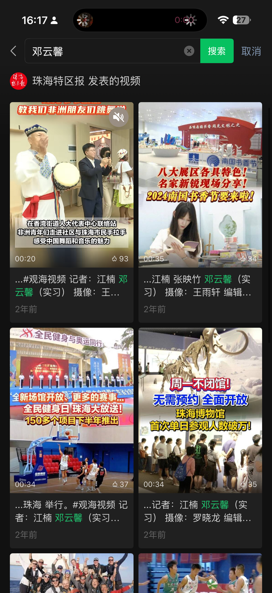
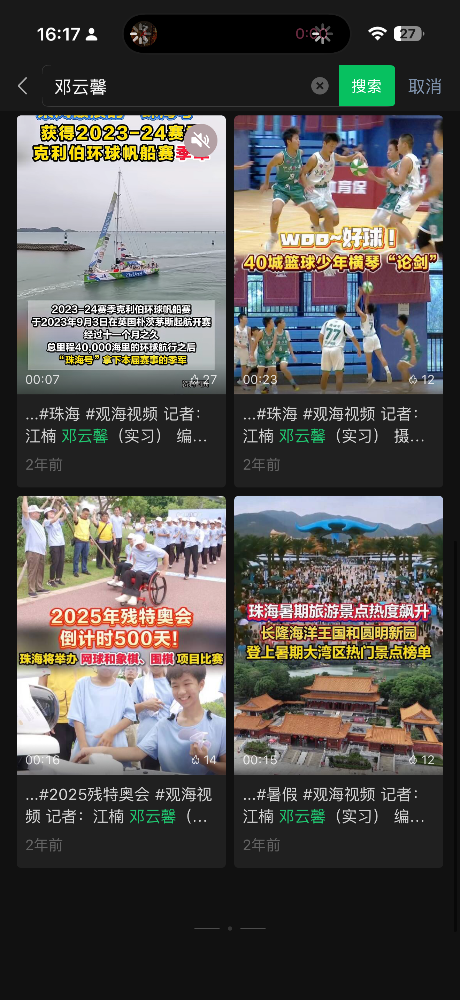
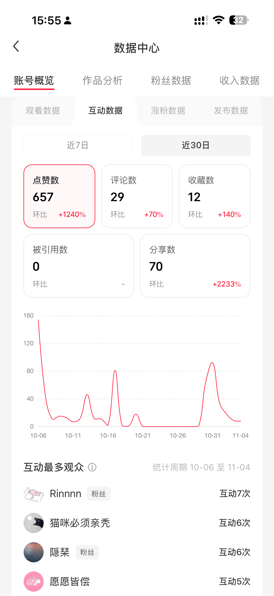
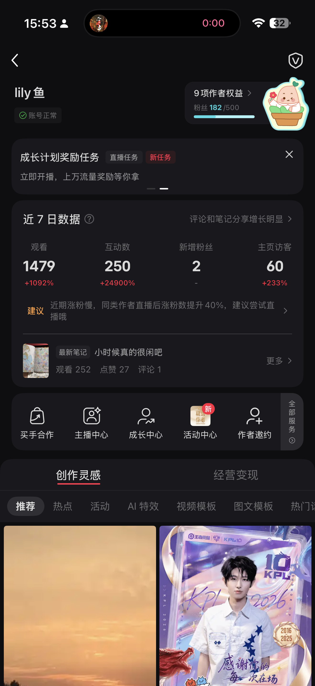

# 图片素材预览目录

这是素材分支中的图片联系表。请在 GitHub 页面打开本文件，逐张查看图片，再根据画面内容为素材归类。当前文件名仍为上传时的随机名称，完成视觉核对后再正式重命名。

### 01 · 0ef1e276f858e22664abb14afe087431.png

[打开原图](https://github.com/dyxsmart/dyxsmart.github.io/blob/portfolio-assets/0ef1e276f858e22664abb14afe087431.png) · PNG

---

### 02 · 0f58f3b06f6efc0eb2419832b09adbd9.jpg

[打开原图](https://github.com/dyxsmart/dyxsmart.github.io/blob/portfolio-assets/0f58f3b06f6efc0eb2419832b09adbd9.jpg) · JPG

---

### 03 · 1c86f13609891c457cae16f867d5b3c0.png

[打开原图](https://github.com/dyxsmart/dyxsmart.github.io/blob/portfolio-assets/1c86f13609891c457cae16f867d5b3c0.png) · PNG

---

### 04 · 7886db7a496747982b9bf1cb426fb520.png

[打开原图](https://github.com/dyxsmart/dyxsmart.github.io/blob/portfolio-assets/7886db7a496747982b9bf1cb426fb520.png) · PNG

---

### 05 · 7a5bdd8c7f75096aec37fb0c3d31fe2a.jpg

[打开原图](https://github.com/dyxsmart/dyxsmart.github.io/blob/portfolio-assets/7a5bdd8c7f75096aec37fb0c3d31fe2a.jpg) · JPG

---

### 06 · 8f8b37ec12c563722f8f917c8301e1a5.png

[打开原图](https://github.com/dyxsmart/dyxsmart.github.io/blob/portfolio-assets/8f8b37ec12c563722f8f917c8301e1a5.png) · PNG

---

### 07 · b8325a52ad97258f8db660bb978f1451.jpg

[打开原图](https://github.com/dyxsmart/dyxsmart.github.io/blob/portfolio-assets/b8325a52ad97258f8db660bb978f1451.jpg) · JPG

---

### 08 · e0b79b24a27877db10f91f2accf34b38.jpg

[打开原图](https://github.com/dyxsmart/dyxsmart.github.io/blob/portfolio-assets/e0b79b24a27877db10f91f2accf34b38.jpg) · JPG

---

### 09 · e60d08de5a5ab7c736d1e9bbb3ab5509.png

[打开原图](https://github.com/dyxsmart/dyxsmart.github.io/blob/portfolio-assets/e60d08de5a5ab7c736d1e9bbb3ab5509.png) · PNG

---

### 10 · f5ac2e630a49e47093c86fb67fc9742c.png

[打开原图](https://github.com/dyxsmart/dyxsmart.github.io/blob/portfolio-assets/f5ac2e630a49e47093c86fb67fc9742c.png) · PNG

---

### 11 · feeda7743fda1cca6a4224e23d839360.png

[打开原图](https://github.com/dyxsmart/dyxsmart.github.io/blob/portfolio-assets/feeda7743fda1cca6a4224e23d839360.png) · PNG
